<div align="center">

# Naul

**게임 클라이언트 개발자 · AI Native 워크플로**

AI 에이전트 팀으로 Unity 게임을 만듭니다. 명세·역할·검증 게이트는 제가 설계하고, 구현은 그 안에서 에이전트가 합니다.

[English](README.md) · [itch.io](https://naul-ds.itch.io)

</div>

---

## 기술 스택

| | |
|---|---|
| **Game** |          |
| **AI** |       |
| **Web / Tools** |       |

---

## 게임 프로젝트

### [Floor F](https://github.com/Naul-s/Floor-F)

`1인` `1주` `Unity 6` `WebGL` · Official 2026 Unity Game Jam · [▶ itch.io에서 플레이](https://naul-ds.itch.io/floor-f)

손님마다 다른 행운·불운의 숫자를 읽으며 운전하는 엘리베이터 퍼즐 시뮬레이션.

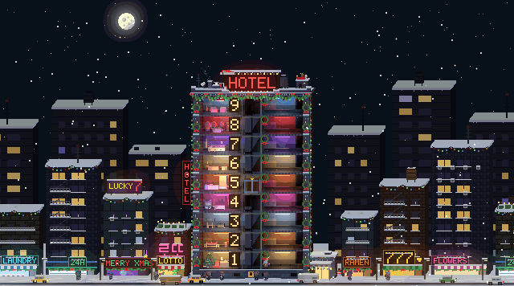

- 엔진 비의존 C# 규칙 코어, Gameplay / Rendering / UI / Audio 어셈블리 분리
- 640×360 픽셀화 렌더 파이프라인, 10일차 · 엔딩 6종, 한/영 지원
- Claude Code 에이전트 8종을 지휘해 1주 만에 완성

<details>
<summary><b>스크린샷</b></summary>
<br>
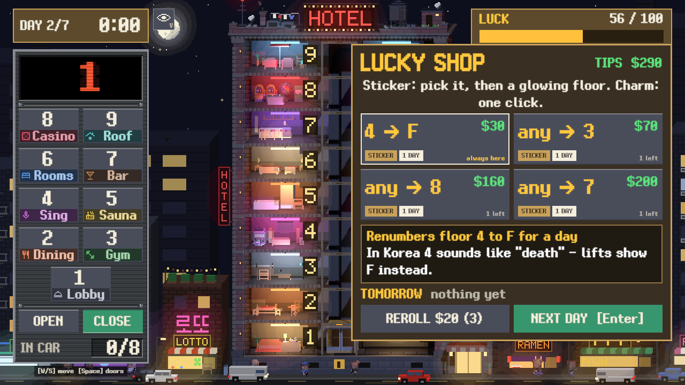 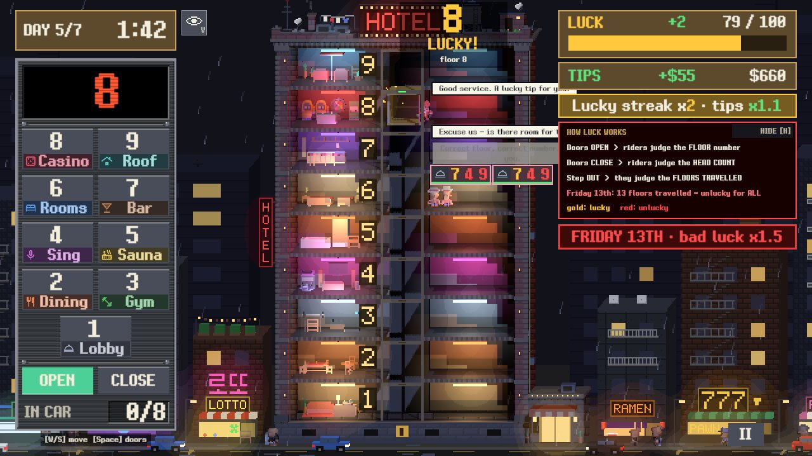
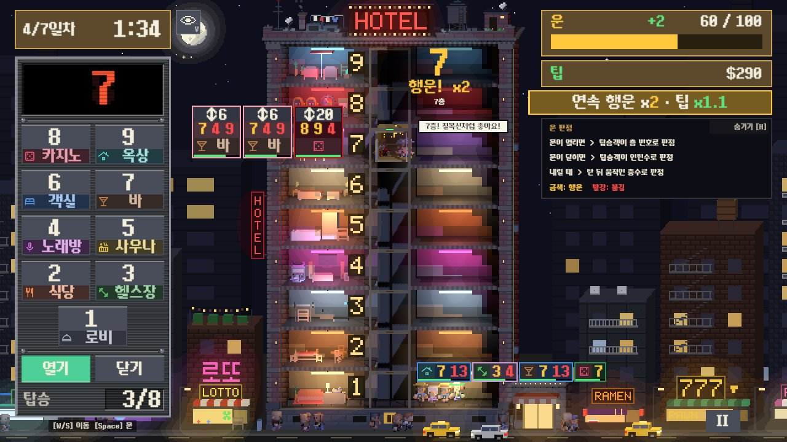
</details>

<details>
<summary><b>AI 워크플로</b></summary>

- 게임플레이·렌더·UI·오디오·콘텐츠·에셋·QA·릴리스 역할 에이전트 8종을 Git worktree로 격리
- 디렉터리 소유권을 훅으로 강제, 공유 계약 변경은 오케스트레이터만 수행
- 검증 사다리: L0 컴파일 → L1 규칙 테스트 → L2 런타임 화면 캡처 → L3 WebGL 빌드
- 테스트 케이스 860개

</details>

### [The Pawntom Heist](https://github.com/EwhaKing/The-Pawntom-Heist)

`6인 팀` `Unity 6` `Photon Fusion 2` `NavMesh`

적 기지에서 보물을 훔쳐 달아나는 1~4인 협동 잠입 게임. 적 AI가 없던 시점에 합류해 PR로 통합.

- 시야·청각·흔적 추적을 갖춘 K-9 적 AI 상태머신
- 적 스폰과 격벽 상태 네트워크 동기화
- 튜토리얼 시스템과 텍스트창, 1인칭 상호작용, 전체 코드 리뷰 및 리팩토링

<details>
<summary><b>스크린샷</b></summary>
<br>
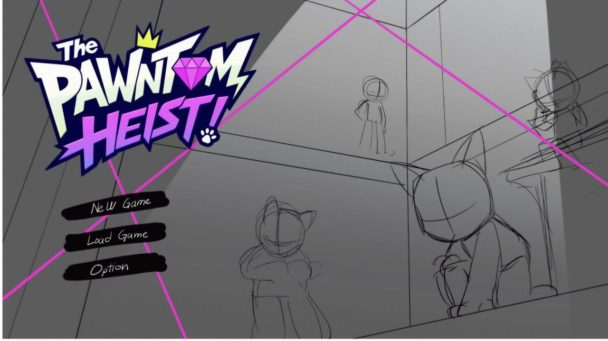 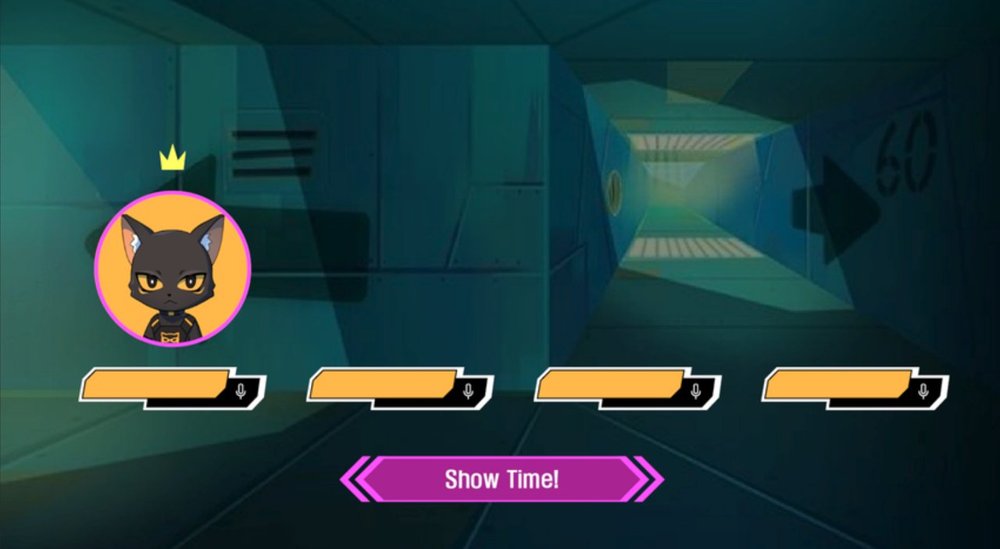
</details>

<details>
<summary><b>AI 워크플로</b></summary>

- 고정 4역할 직렬 구조에서 7역할 동적 오케스트레이션으로 하네스 재설계
- 위험도별 R0~R3 라우팅, 계획 승인 게이트, 3관점 독립 리뷰
- 검증 기록 38건 보존 · main 기준 C# 약 2.2만 줄 · PR 6건 병합

</details>

### Project SR

`1인` `개발 중` `Unity 6` `FMOD` `Windows API` · Private

기어 전환을 조합한 3D 4레인 리듬게임과 채보 에디터. Steam 출시 목표.

- FMOD와 Windows API 기반 저지연 오디오, DSP 스케줄 재생, 음원 offset 자동 보정
- WAV · OGG · MP3 음원 자동 인식
- 엔진·FMOD에 의존하지 않는 판정 코어와 계층형 아키텍처

<details>
<summary><b>스크린샷</b></summary>
<br>
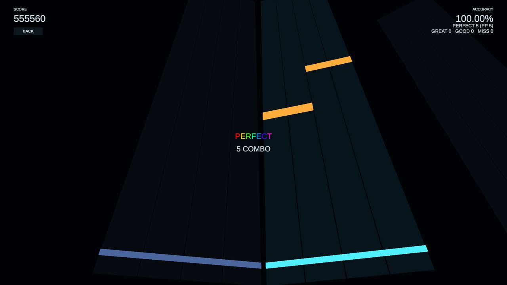
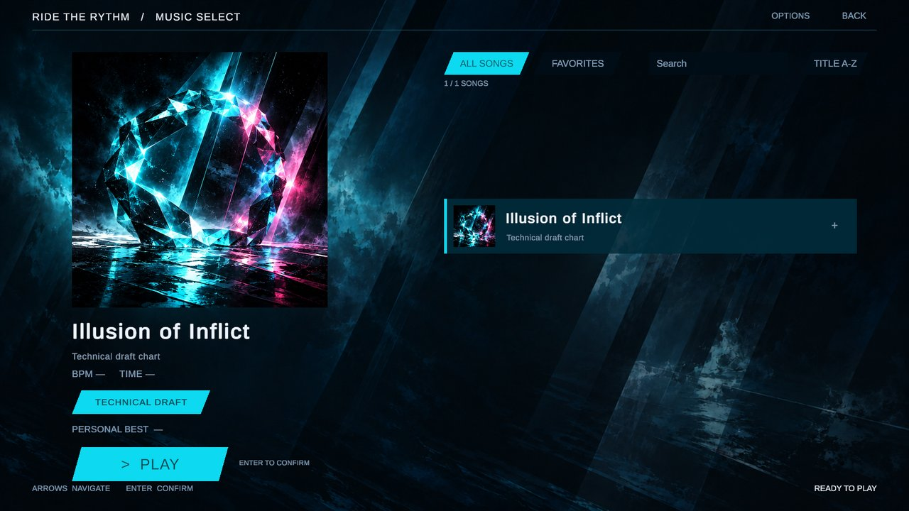 
</details>

<details>
<summary><b>AI 워크플로</b></summary>

- 판정 계약 · JSON Schema · golden vector를 구현 전에 고정
- 테스트 케이스 589개 · 지연·판정·시각 리뷰용 도메인 전용 Codex 스킬
- 고정 5역할 멀티에이전트를 운영해 한계를 확인하고 단일 오너 + 스킬 구조로 전환

</details>

### SHELTER

`3인 팀` `Unity 6` `OpenXR` `Meta Quest` · Private

쉘터에서 10라운드 동안 좀비를 막아내는 VR 서바이벌.

- 적 AI, 자원·적 스폰과 오브젝트 풀링
- ScriptableObject 기반 데이터 관리, VR 카메라 트래킹
- Quest 최적화: 메시 병합, LOD, 라이트맵, 포비에이티드 렌더링

<details>
<summary><b>스크린샷</b></summary>
<br>
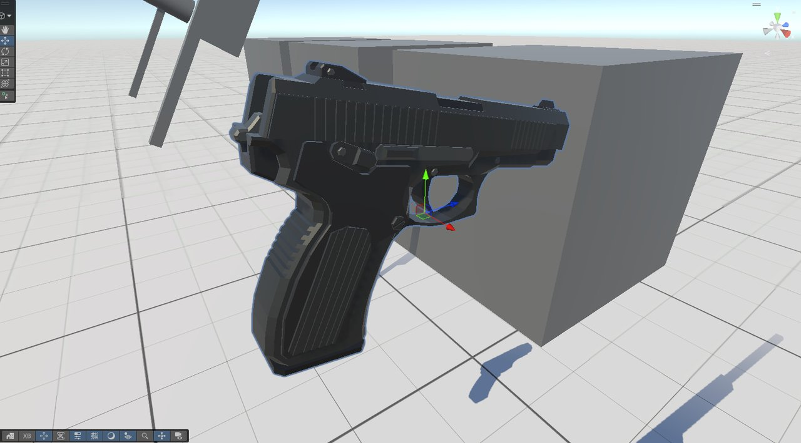 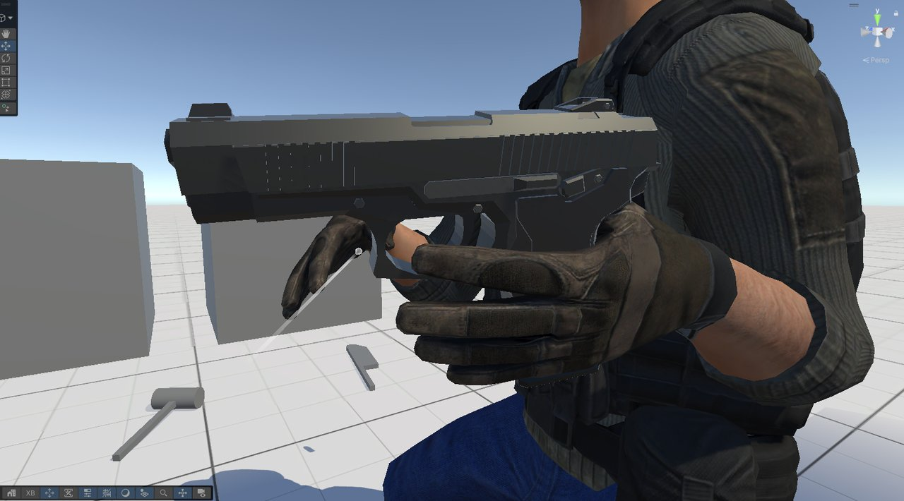
</details>

### Trincle

`6인 팀` `4개월` `Unity` · 개발 중단

무기 스킬·제작·절차적 맵을 갖춘 탑다운 픽셀 액션 게임.

- 탑다운 캐릭터 이동과 상태 기반 스프라이트 애니메이션
- 셰이더 기반 무기 스킬, 타격 VFX, 공격 셰이더 최적화
- 펄린 노이즈 기반 절차적 맵 생성
- ScriptableObject 기반 아이템 드랍·대화창, 인벤토리·제작 UI, 전체 SFX

<details>
<summary><b>스크린샷</b></summary>
<br>
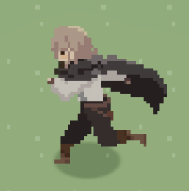 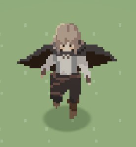 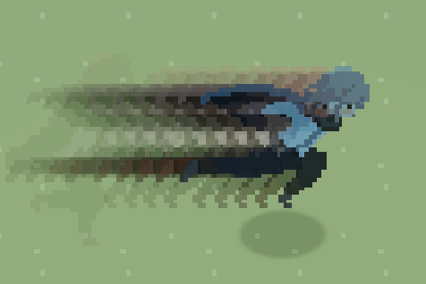
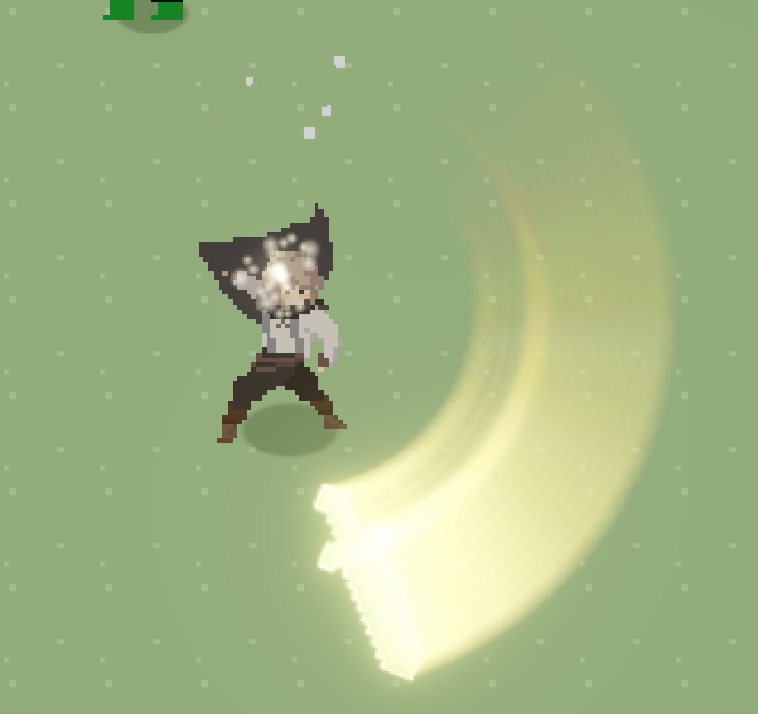 
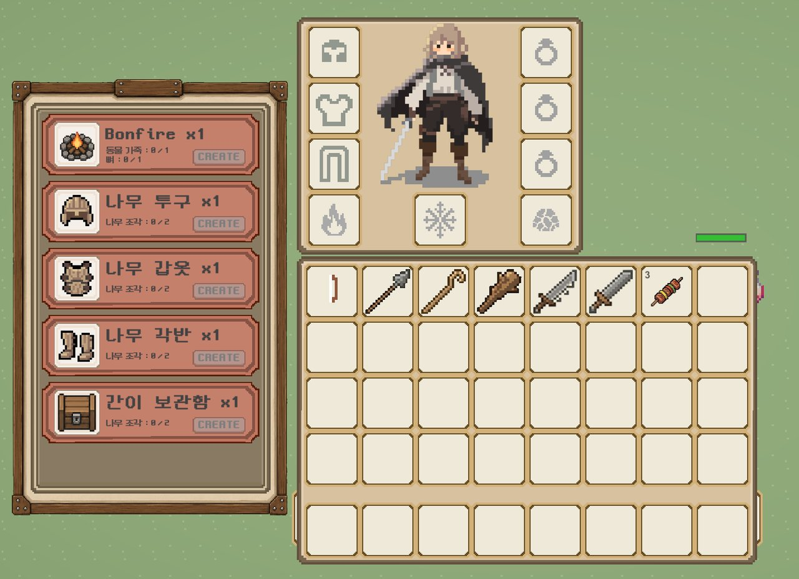 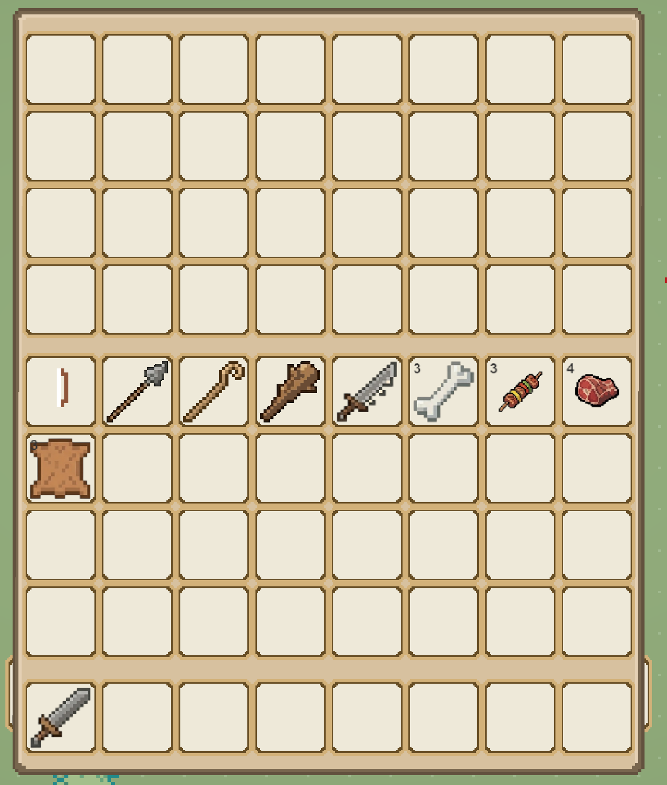
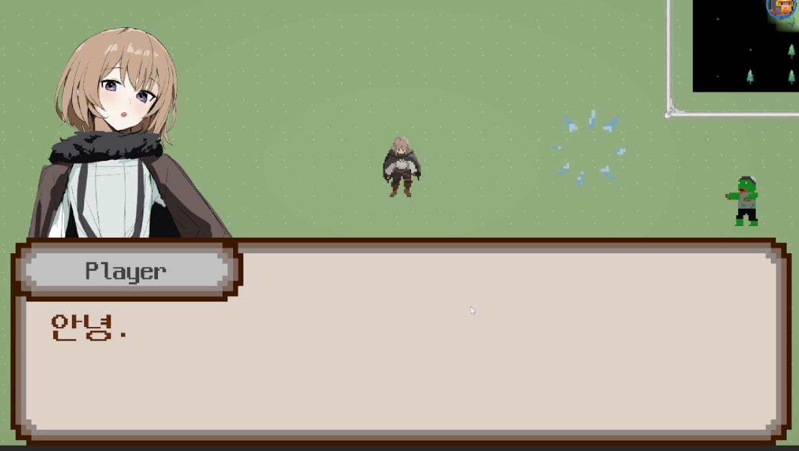
</details>

### Music of the Soul

`1인` `8개월` `Unity` `PlayFab` `Photon`

온라인 대전을 지원하는 리듬게임. AI 에이전트를 쓰기 전에 만든 첫 완성작.

- PlayFab 회원가입·로그인, 게임 내 데이터 동기화
- Photon 멀티플레이
- 오브젝트 풀링과 Unity Profiler 기반 메모리·스크립트 최적화

<details>
<summary><b>스크린샷</b></summary>
<br>
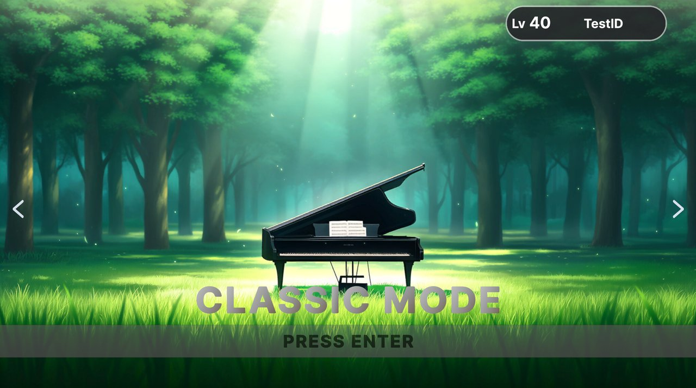 
</details>

### Snow Removal Master

`1인` `TypeScript` `React` `Three.js` · [▶ 플레이](https://snow-removal-master.vercel.app)

절차 생성 Endless 모드와 스테이지 에디터를 갖춘 로우폴리 3D 한붓그리기 퍼즐. 작업 42건 전부 지시 → 보고 → 독립 리뷰로 추적.

---

## AI 프로젝트

### 멀티에이전트 개발 워크플로

`개인 아키텍처` · 위 게임 프로젝트 전반에 적용

단일 에이전트는 요청 범위를 벗어나 수정하거나, 명시되지 않은 요구사항을 추측하거나, 자기 오류를 놓쳤습니다. 역할별 에이전트와 명시적 승인 게이트로 작업을 나눴습니다.

- **역할:** Coordinator, Planner, Plan Reviewer, Builder, Code Reviewer, Reporter. 리뷰어는 수정하지 않음
- **위험도 등급:** T0 / T1 / T2. 위험한 작업에만 계획 검토와 2차 승인 적용
- **결정 상태:** Confirmed / Candidate / Open Gate로 구분해 추측이 요구사항으로 바뀌지 않게 함
- **핸드오프:** 전체 로그 대신 목표·승인 상태·제약만 전달해 토큰 사용량 절감

<details>
<summary><b>워크플로</b></summary>

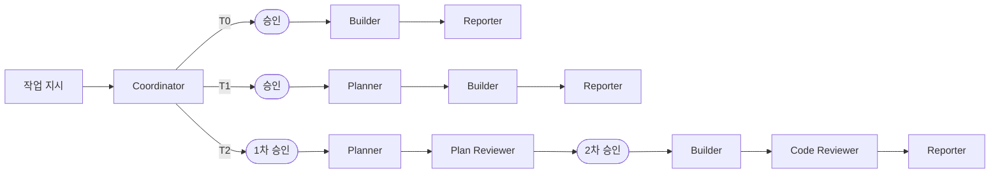

</details>

<details>
<summary><b>발전 과정</b></summary>

```
2025      에이전트 없이 게임 개발 기본기
2026.04   규칙 파일과 Unity MCP를 보조 도구로 활용
2026.08   고정 역할(계획 → 구현 → 리뷰)과 작업 원장
2026.09   계약·테스트 우선 개발, 고정 역할 구조 폐기
2026.10   위험도 라우팅, 동적 오케스트레이션, 증거 게이트
2026.11   병렬 에이전트 팀으로 1주 만에 게임 완성, AI 결과물 검증 도구 제작
```

</details>

### [SlopLens](https://github.com/Naul-s/slop-lens)

`1인` `오픈소스` `Python` `MCP` `Unity`

AI로 만든 게임·웹이 왜 "AI 슬롭"처럼 느껴지는지 근거와 수정안으로 설명하는 Claude Code 플러그인 · MCP 서버.

- 플레이 프레임과 믹스 오디오를 캡처하는 Unity 자동 플레이 패키지
- Claude Code, Gemini CLI, Codex, Cursor 지원
- 실패 결과를 포함한 검증 수치 공개

### 실시간 음성번역 Chrome 확장

`1인` `3일` `Chrome Extension` `WebGPU`

YouTube·Twitch 영상 음성을 클라우드 API 없이 브라우저 안에서 실시간 자막으로 번역.

- 탭 오디오 → AudioWorklet VAD → Whisper STT → Qwen2.5 또는 OPUS-MT, 모델별 Web Worker 분리
- WebGPU에서 q4/q8 양자화 모델 실행, STT는 WASM 폴백
- 시스템 프롬프트·few-shot·디코딩 설정으로 번역문만 출력하도록 제어, 토큰 단위 스트리밍 자막

<details>
<summary><b>스크린샷</b></summary>
<br>
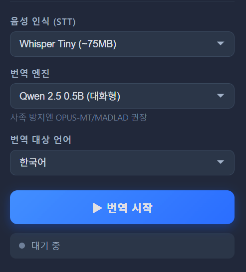 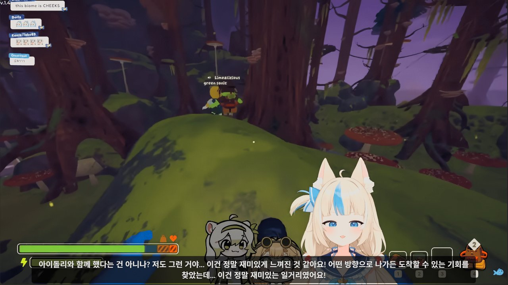
</details>

### 시각장애인 AI 보조도구

`1인` `8시간` `Raspberry Pi` `Python` · 전주시 청소년 IP 해커톤 **금상**

Raspberry Pi 카메라 이미지를 비전 AI API로 분석해 사용자 앞의 물체와 상황을 설명.

- Raspberry Pi Linux 환경 구성, Python으로 카메라 입력과 API 호출 연결
- 응답이 길어지거나 불확실한 내용을 단정하지 않도록 프롬프트와 출력 방식 조정

<details>
<summary><b>사진</b></summary>
<br>
 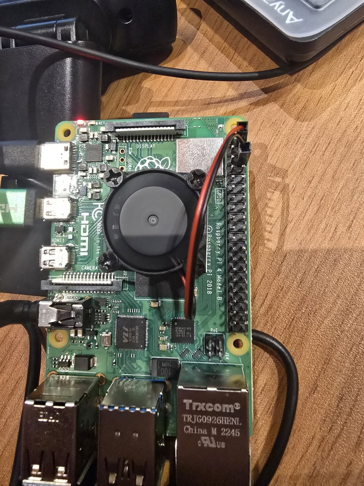
</details>

---

## 수상 · 활동

| 시기 | |
|---|---|
| 2025.12 | 전주시 청소년 IP 해커톤 — **금상** |
| 2025.06 | 정보처리기능사 |
| 2025.04 – | 교내 게임 개발 동아리 공동 설립 · 회장, C#·Unity 교육 |
| 2024.04 | 지방기능경기대회 — **은메달** |
