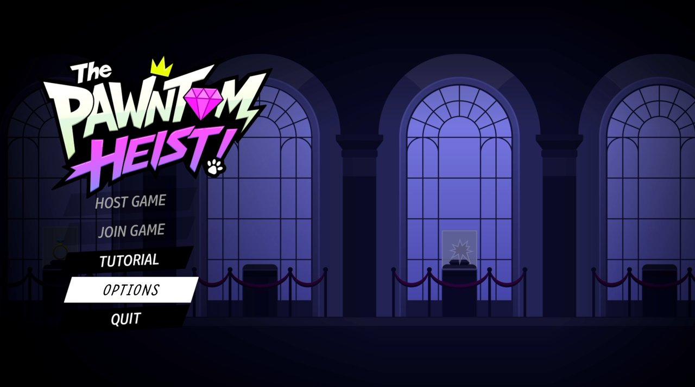
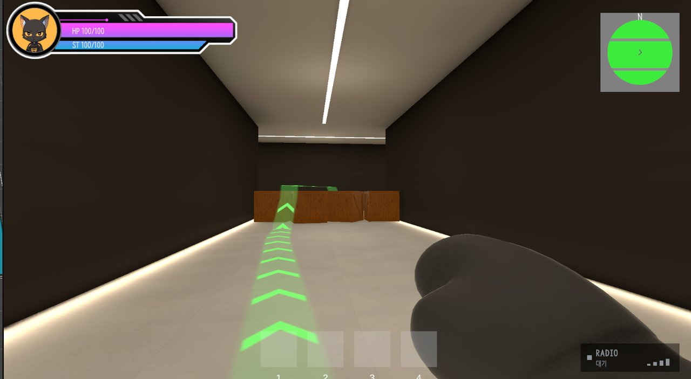
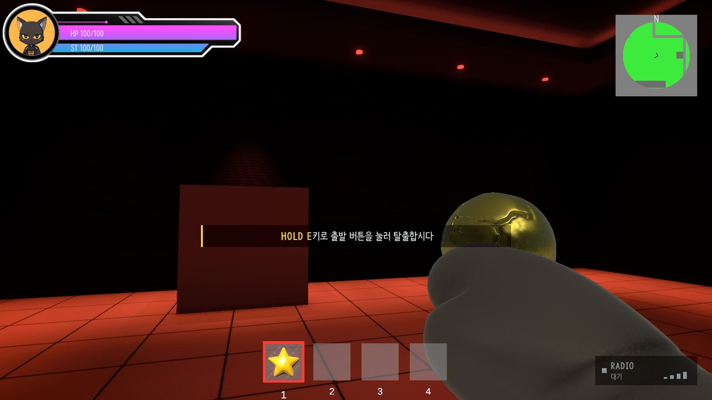
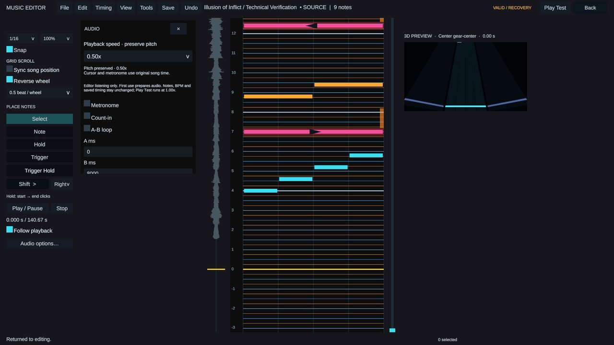
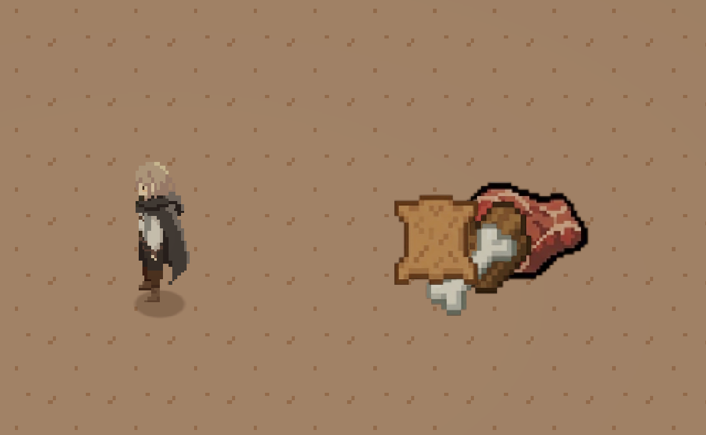
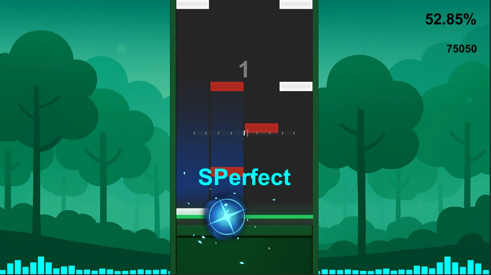
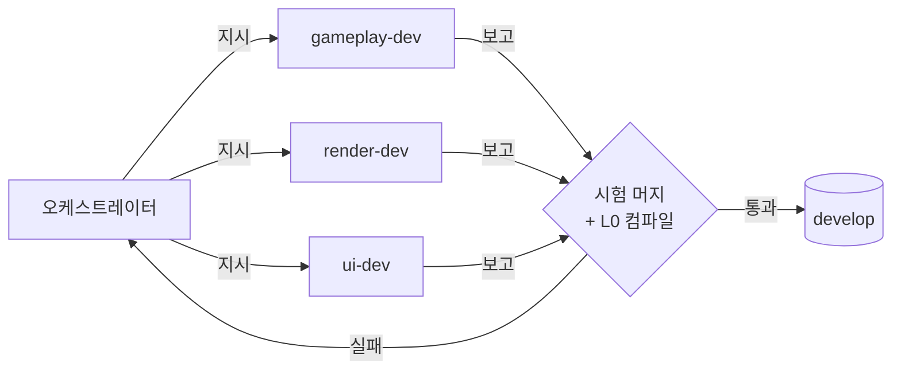
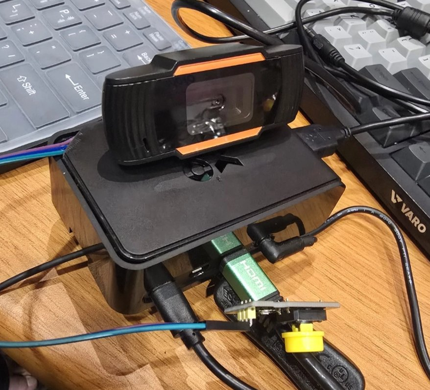

<div align="center">

# Naul

**게임 클라이언트 개발자 · AI Native 워크플로**

AI 에이전트 팀으로 Unity 게임을 만듭니다. 명세·역할·검증 게이트는 제가 설계하고, 구현은 그 안에서 에이전트가 합니다.

[English](README.md) · [itch.io](https://naul-ds.itch.io)

<br>

       <br>
     <br>
    

</div>

---

## 대표 게임

### [Floor F](https://github.com/Naul-s/Floor-F)

<sub>1인 · 1주 · Unity 6 · WebGL · Official 2026 Unity Game Jam</sub> · [▶ itch.io에서 플레이](https://naul-ds.itch.io/floor-f)

손님마다 다른 행운·불운의 숫자를 읽으며 운전하는 엘리베이터 퍼즐 시뮬레이션.


- 엔진 비의존 C# 규칙 코어, Gameplay / Rendering / UI / Audio 어셈블리 분리
- 640×360 픽셀화 렌더 파이프라인, 10일차 · 엔딩 6종, 한/영 지원
- **AI:** 역할 에이전트 8종을 Git worktree로 격리, 훅으로 소유권 강제, L0 컴파일 → L1 테스트 → L2 화면 캡처 → L3 WebGL 빌드 검증, 테스트 케이스 860개

<details>
<summary>스크린샷</summary>
<br>
 
</details>

### [The Pawntom Heist](https://github.com/EwhaKing/The-Pawntom-Heist)

<sub>6인 팀 · Unity 6 · Photon Fusion 2 · NavMesh</sub>

1~4인 협동 잠입 게임. 적 AI가 없던 시점에 합류해 PR로 통합.



- 시야·청각·흔적 추적을 갖춘 K-9 적 AI와 네트워크 동기화
- 튜토리얼 시스템, 1인칭 상호작용, 전체 코드 리뷰 및 리팩토링
- **AI:** 고정 4역할 구조에서 위험도 라우팅을 갖춘 7역할 동적 오케스트레이션으로 하네스 재설계 · PR 6건 병합

<details>
<summary>스크린샷</summary>
<br>
 
</details>

### Project SR

<sub>1인 · 개발 중 · Unity 6 · FMOD · Windows API · Private</sub>

기어 전환을 조합한 3D 4레인 리듬게임과 채보 에디터. Steam 출시 목표.


- FMOD와 Windows API 기반 저지연 오디오, DSP 스케줄 재생, 음원 offset 자동 보정
- 엔진·FMOD 비의존 판정 코어, WAV · OGG · MP3 자동 인식
- **AI:** 판정 계약 · JSON Schema · golden vector를 구현 전에 고정 · 테스트 케이스 589개

<details>
<summary>스크린샷</summary>
<br>
 
</details>

### 기타 게임

| 프로젝트 | 설명 |
|---|---|
| **SHELTER**<br><sub>3인 팀 · VR · Private</sub> | Meta Quest용 VR 좀비 서바이벌. 적 AI, 풀링 기반 스폰, ScriptableObject 데이터, Quest 최적화(LOD, 라이트맵, 포비에이티드 렌더링).<details><summary>스크린샷</summary> </details> |
| **Trincle**<br><sub>6인 팀 · Unity</sub> | 탑다운 픽셀 액션. 셰이더 기반 무기 스킬, 타격 VFX, 펄린 노이즈 맵 생성, ScriptableObject 아이템 드랍·대화창, 인벤토리·제작 UI.<details><summary>스크린샷</summary>   </details> |
| **Music of the Soul**<br><sub>1인 · Unity · 2025</sub> | 온라인 대전 리듬게임. PlayFab 로그인·데이터 동기화, Photon 멀티플레이, 오브젝트 풀링과 Profiler 기반 최적화.<details><summary>스크린샷</summary> </details> |
| **Snow Removal Master**<br><sub>1인 · Web</sub> | React · Three.js 로우폴리 3D 한붓그리기 퍼즐. 절차 생성 Endless 모드와 스테이지 에디터. [▶ 플레이](https://snow-removal-master.vercel.app) |

---

## AI 프로젝트

### AI 개발 워크플로

<sub>에이전트 워크플로의 발전 · 2026.08 → 2026.11</sub>

처음에는 공정 단계별 역할을 고정한 파이프라인으로 시작했고, 실제 프로젝트에 운영해 본 뒤 모듈 소유권과 자동 검증 중심으로 다시 설계했습니다.

| | 이전 · 고정 파이프라인 | 현재 · 오케스트레이션 팀 |
|---|---|---|
| **구조** | 계획 → 검토 → 구현 → 검토 → 보고의 6역할 직렬 구조 | 오케스트레이터 + 도메인 에이전트 8종(게임플레이, 렌더, UI, 오디오, 콘텐츠, 에셋, QA, 릴리스) |
| **병렬성** | 한 번에 한 작업 | 쓰기 에이전트 최대 3개 동시 실행, 각자 별도 Git worktree |
| **충돌 방지** | 작업마다 수정 허용 파일 목록 | 디렉터리 소유권을 훅으로 강제, 공유 계약은 먼저 고정하고 오케스트레이터만 변경 |
| **완료 판정** | 리뷰 에이전트의 PASS | 자동 검증 통과: L0 컴파일(4초) → L1 테스트 → L2 런타임 화면 캡처 → L3 WebGL 빌드 |
| **통합** | 수동 | 시험 머지 + 컴파일, 실패 시 develop은 그대로 두고 담당 에이전트에게 반려 |
| **사람의 역할** | 계획마다 승인, 고위험 작업은 2차 승인 | 계약·방향 설정, 에셋·푸시 승인, 손맛 판단 |
| **적용** | Snow Removal Master, Project SR | Floor F: 1주 만에 플레이 가능한 WebGL 게임 완성, 테스트 케이스 860개 |

**처음 버전에서 유지한 것:** 결정은 사람이 승인, 말이 아닌 증거로 완료 판정, 전체 로그 대신 고정 양식의 짧은 지시·보고.

<details>
<summary>현재 파이프라인과 발전 과정</summary>



```
2025      에이전트 없이 게임 개발 기본기
2026.04   규칙 파일과 Unity MCP를 보조 도구로 활용
2026.08   고정 역할 파이프라인과 작업 원장
2026.09   계약·테스트 우선 개발, 고정 역할 구조 폐기
2026.10   위험도 라우팅, 동적 오케스트레이션, 증거 게이트
2026.11   오케스트레이션 병렬 팀으로 1주 만에 게임 완성, AI 결과물 검증 도구 제작
```

</details>

### 기타 AI 프로젝트

| 프로젝트 | 설명 |
|---|---|
| **[SlopLens](https://github.com/Naul-s/slop-lens)**<br><sub>1인 · 오픈소스</sub> | AI로 만든 게임·웹이 왜 "AI 슬롭"처럼 느껴지는지 설명하는 Claude Code 플러그인 · MCP 서버. Unity 자동 플레이로 프레임·오디오 캡처, 실패를 포함한 검증 결과 공개. |
| **실시간 음성번역**<br><sub>1인 · Chrome 확장</sub> | YouTube·Twitch 음성을 브라우저 안에서 실시간 자막으로 번역. WebGPU에서 Whisper STT와 Qwen2.5 / OPUS-MT를 q4/q8 양자화로 실행, VAD, 토큰 스트리밍, 클라우드 API 없음.<details><summary>스크린샷</summary> </details> |
| **시각장애인 AI 보조도구**<br><sub>1인 · 8시간 · 해커톤 금상</sub> | Raspberry Pi 카메라 이미지를 비전 AI API로 분석해 사용자 앞의 상황을 설명. 응답이 길어지거나 불확실한 내용을 단정하지 않도록 프롬프트 조정.<details><summary>사진</summary> </details> |

---

## 수상 · 활동

| 시기 | |
|---|---|
| 2025.12 | 전주시 청소년 IP 해커톤 — **금상** |
| 2025.06 | 정보처리기능사 |
| 2025.04 – | 교내 게임 개발 동아리 공동 설립 · 회장, C#·Unity 교육 |
| 2024.04 | 지방기능경기대회 — **은메달** |
