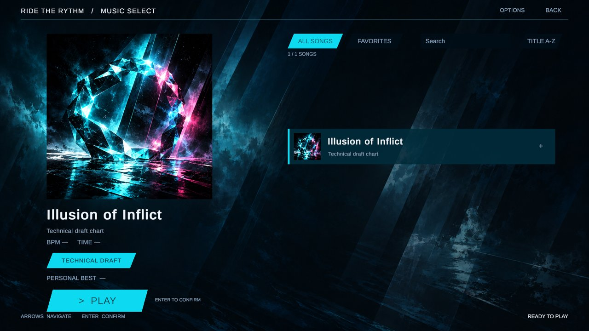
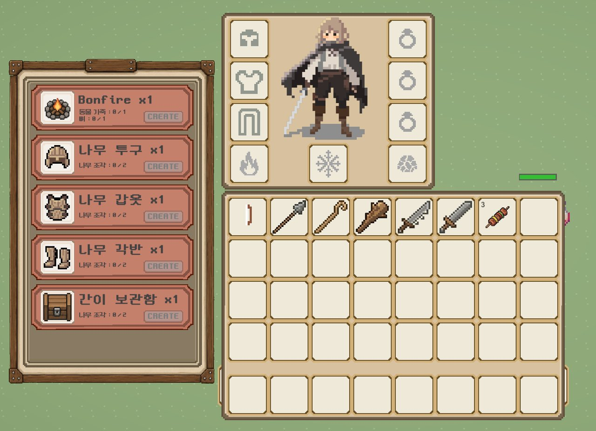
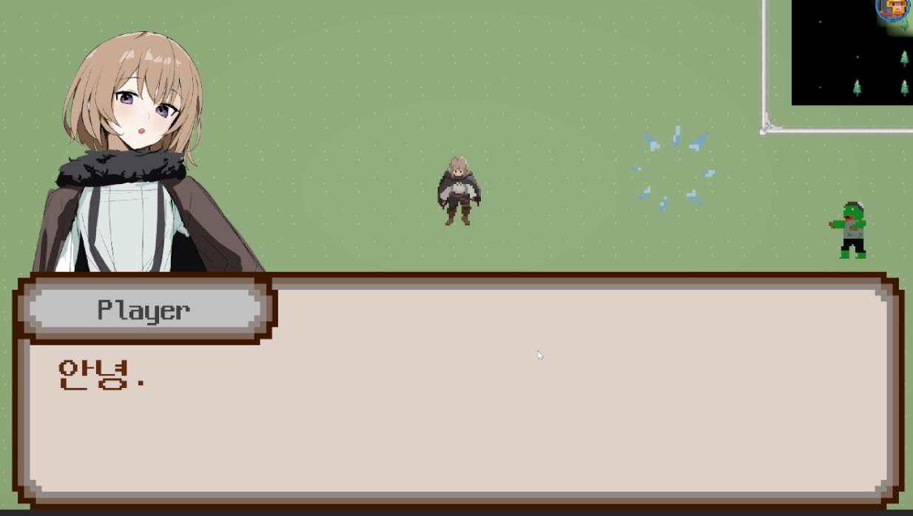
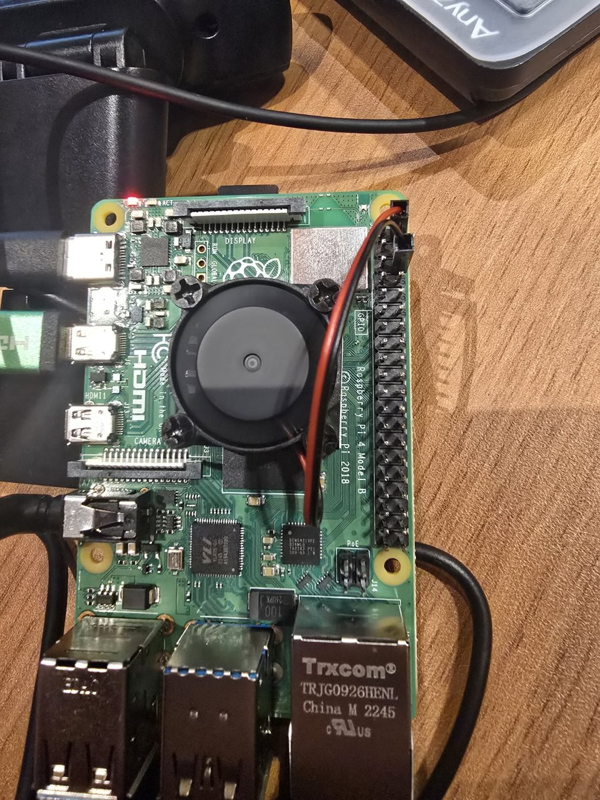

<div align="center">

# Naul

**Game Client Developer · AI-Native Workflow**

I build Unity games with AI agent teams: I design the specs, roles, and verification gates; agents implement inside them.

[한국어](README.ko.md) · [itch.io](https://naul-ds.itch.io)

<br>

       <br>
     <br>
    

</div>

---

## Featured Games

### [Floor F](https://github.com/Naul-s/Floor-F)

<sub>Solo · 1 week · Unity 6 · WebGL · Official 2026 Unity Game Jam</sub> · [▶ Play on itch.io](https://naul-ds.itch.io/floor-f)

Elevator puzzle sim where every guest has a lucky and an unlucky number.


- Engine-free C# rule core; Gameplay / Rendering / UI / Audio split into assemblies
- 640×360 pixelated render pipeline, 10 nights, 6 endings, English and Korean
- **AI:** 8 role agents in isolated Git worktrees, ownership enforced by hooks, L0 compile → L1 tests → L2 screen capture → L3 WebGL build, 860 test cases

<details>
<summary>Screenshots</summary>
<br>
 
</details>

### [The Pawntom Heist](https://github.com/EwhaKing/The-Pawntom-Heist)

<sub>Team of 6 · Unity 6 · Photon Fusion 2 · NavMesh</sub>

1–4 player co-op stealth game. Joined when the game had no enemy AI and shipped it through PRs.


- K-9 enemy AI with sight, hearing, and trace tracking, synced over the network
- Tutorial system, first-person interaction, codebase-wide review and refactor
- **AI:** Harness redesigned from 4 fixed roles to 7-role dynamic orchestration with risk-based routing · 6 PRs merged

<details>
<summary>Screenshots</summary>
<br>
 
</details>

### Project SR

<sub>Solo · In development · Unity 6 · FMOD · Windows API · Private</sub>

3D four-lane rhythm game with gear shifts and a chart editor. Targeting Steam.


- Low-latency audio with FMOD and Windows API, DSP-scheduled playback, automatic offset calibration
- Judgment core independent of the engine and FMOD; auto-detects WAV, OGG, MP3
- **AI:** Judgment contract, JSON Schema, and golden vectors fixed before implementation · 589 test cases

<details>
<summary>Screenshots</summary>
<br>
 
</details>

### More Games

| Project | |
|---|---|
| **SHELTER**<br><sub>Team of 3 · VR · Private</sub> | VR zombie survival for Meta Quest. Enemy AI, pooled spawning, ScriptableObject data, Quest optimization (LOD, lightmaps, foveated rendering).<details><summary>Screenshots</summary> </details> |
| **Trincle**<br><sub>Team of 6 · Unity</sub> | Top-down pixel action. Shader-based weapon skills, hit VFX, Perlin-noise map generation, ScriptableObject item drops and dialogue, inventory and crafting UI.<details><summary>Screenshots</summary>   </details> |
| **Music of the Soul**<br><sub>Solo · Unity · 2025</sub> | Rhythm game with online versus. PlayFab login and data sync, Photon multiplayer, object pooling and Profiler-driven optimization.<details><summary>Screenshots</summary> </details> |
| **Snow Removal Master**<br><sub>Solo · Web</sub> | Low-poly 3D one-stroke puzzle in React and Three.js with a procedural Endless mode and stage editor. [▶ Play](https://snow-removal-master.vercel.app) |

---

## AI Projects

### Multi-Agent Development Workflow

<sub>Personal architecture · Applied across the games above</sub>

Single agents drifted out of scope, guessed at unstated requirements, and missed their own bugs. I split the work across role agents with explicit approval gates.

- **Roles:** Coordinator, Planner, Plan Reviewer, Builder, Code Reviewer, Reporter. Reviewers never edit.
- **Risk tiers:** T0 / T1 / T2. Plan review and a second approval only for risky work.
- **Decision states:** Confirmed / Candidate / Open Gate, so a guess never becomes a requirement.
- **Handoffs:** objective, approvals, and constraints instead of full logs.

<details>
<summary>Workflow and evolution</summary>


```
2025      Game dev fundamentals without agents
2026.04   Rule files and Unity MCP as assistants
2026.08   Fixed roles (plan → build → review) with a task ledger
2026.09   Contract- and test-first development; dropped the fixed roles
2026.10   Risk-based routing, dynamic orchestration, evidence gates
2026.11   Parallel agent team ships a game in a week; built an AI-output QA tool
```

</details>

### More AI Projects

| Project | |
|---|---|
| **[SlopLens](https://github.com/Naul-s/slop-lens)**<br><sub>Solo · Open source</sub> | Claude Code plugin and MCP server that explains why an AI-made game or website feels like "AI slop". Unity autoplay capture of frames and audio; validation results published, including failures. |
| **Real-Time Translator**<br><sub>Solo · Chrome extension</sub> | Live subtitles for YouTube and Twitch, fully in-browser. Whisper STT and Qwen2.5 / OPUS-MT on WebGPU with q4/q8 quantization, VAD, token streaming, no cloud API.<details><summary>Screenshots</summary> </details> |
| **AI Vision Assistive Device**<br><sub>Solo · 8 hours · Hackathon Gold</sub> | Raspberry Pi camera sends images to a vision AI API and describes the scene to visually impaired users. Prompts tuned to stay short and never state uncertain details as fact.<details><summary>Photos</summary> </details> |

---

## Awards & Activities

| Date | |
|---|---|
| 2025.12 | Jeonju Youth IP Hackathon — **Gold Prize** |
| 2025.06 | Craftsman Information Processing (정보처리기능사) |
| 2025.04 – | Co-founder & president, school game development club · taught C# and Unity |
| 2024.04 | Regional Skills Competition — **Silver Medal** |
