<div align="center">

# Naul

**Game Client Developer · AI-Native Workflow**

I build Unity games with AI agent teams: I design the specs, roles, and verification gates; agents implement inside them.

[한국어](README.ko.md) · [itch.io](https://naul-ds.itch.io)

</div>

---

## Tech Stack

| | |
|---|---|
| **Game** |          |
| **AI** |       |
| **Web / Tools** |       |

---

## Game Projects

### [Floor F](https://github.com/Naul-s/Floor-F)

`Solo` `1 week` `Unity 6` `WebGL` · Official 2026 Unity Game Jam · [▶ Play on itch.io](https://naul-ds.itch.io/floor-f)

Elevator puzzle sim where every guest has a lucky and an unlucky number.

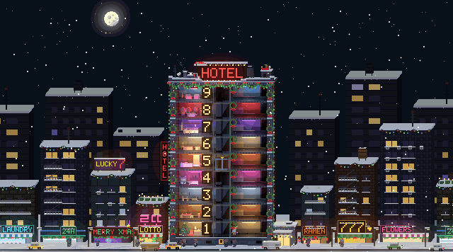

- Engine-free C# rule core; Gameplay / Rendering / UI / Audio split into separate assemblies
- 640×360 pixelated render pipeline, 10 nights, 6 endings, English and Korean
- Built in one week by directing an 8-agent Claude Code team

<details>
<summary><b>Screenshots</b></summary>
<br>
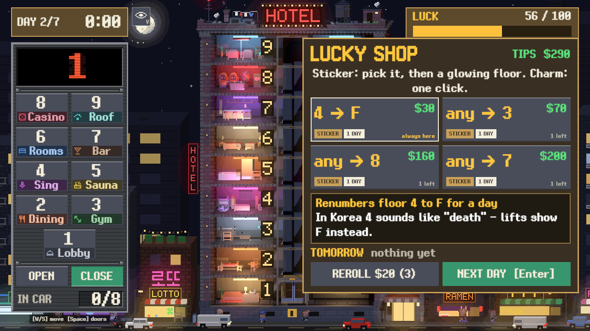 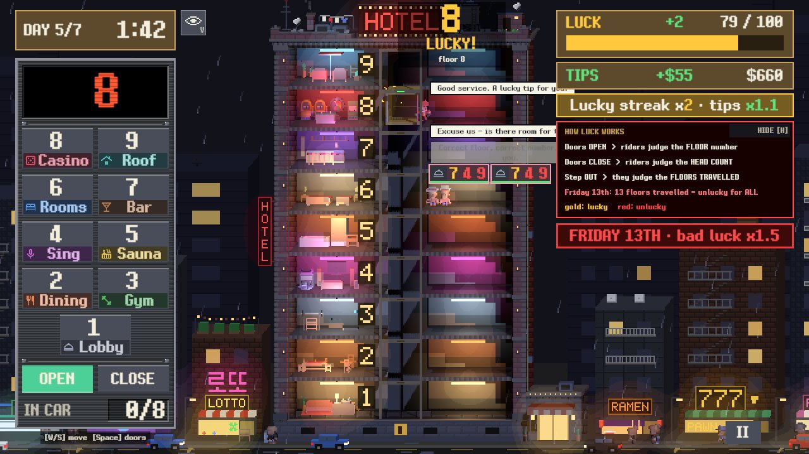
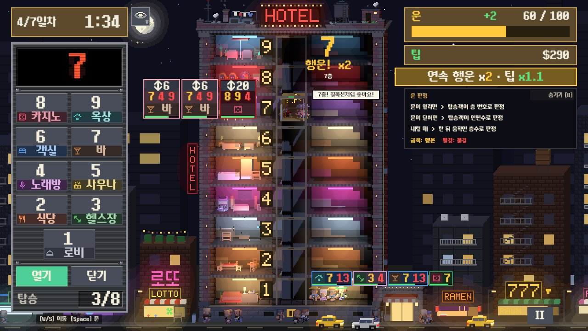
</details>

<details>
<summary><b>AI workflow</b></summary>

- 8 role agents (gameplay, render, UI, audio, content, asset, QA, release) in isolated Git worktrees
- Directory ownership enforced by hooks; shared contracts changed only by the orchestrator
- Verification ladder: L0 compile → L1 rule tests → L2 runtime screen capture → L3 WebGL build
- 860 test cases

</details>

### [The Pawntom Heist](https://github.com/EwhaKing/The-Pawntom-Heist)

`Team of 6` `Unity 6` `Photon Fusion 2` `NavMesh`

1–4 player co-op stealth game: steal the treasure from an enemy base and escape. I joined when the game had no enemy AI and shipped it through PRs.

- K-9 enemy AI: state machine with sight, hearing, and trace tracking
- Networked enemy spawn and bulkhead state sync
- Tutorial system and text UI, first-person interaction, codebase-wide review and refactor

<details>
<summary><b>Screenshots</b></summary>
<br>
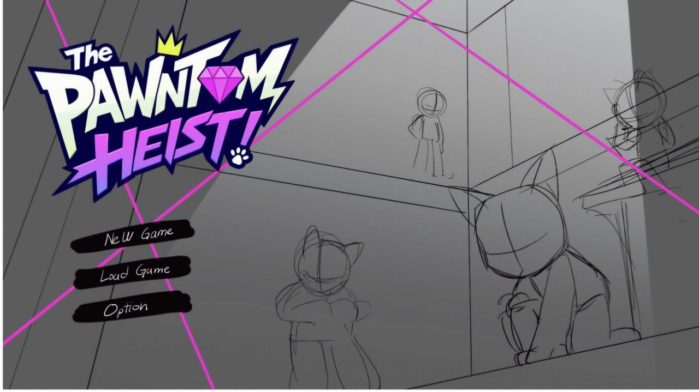 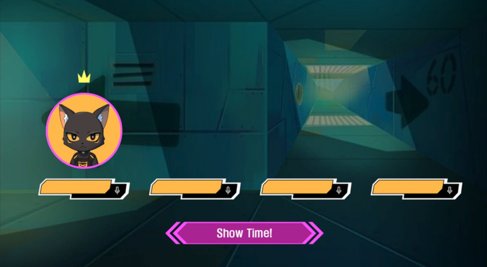
</details>

<details>
<summary><b>AI workflow</b></summary>

- Harness redesigned from 4 fixed serial roles to 7-role dynamic orchestration
- Risk-based R0–R3 routing, plan approval gate, 3-perspective independent review
- 38 verification records preserved · ~22k lines of C# on main · 6 PRs merged

</details>

### Project SR

`Solo` `In development` `Unity 6` `FMOD` `Windows API` · Private

3D four-lane rhythm game with gear shifts, plus a chart editor. Targeting Steam.

- Low-latency audio with FMOD and Windows API, DSP-scheduled playback, automatic offset calibration
- Auto-detects WAV, OGG, and MP3 songs
- Layered architecture with a judgment core independent of the engine and FMOD

<details>
<summary><b>Screenshots</b></summary>
<br>
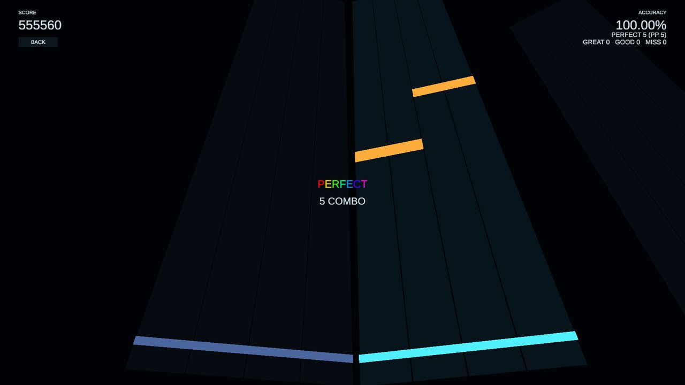
 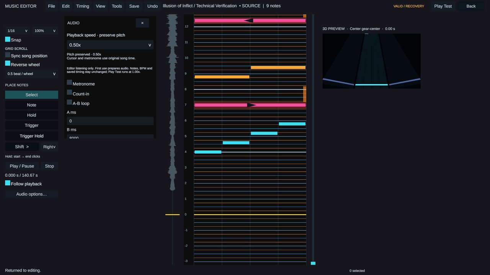
</details>

<details>
<summary><b>AI workflow</b></summary>

- Judgment contract, JSON Schema, and golden vectors fixed before implementation
- 589 test cases · domain-specific Codex skills for latency, judgment, and visual review
- Ran a fixed 5-role multi-agent system, found its limits, replaced it with a single owner plus skills

</details>

### SHELTER

`Team of 3` `Unity 6` `OpenXR` `Meta Quest` · Private

VR zombie survival: hold the shelter for 10 rounds.

- Enemy AI, resource and enemy spawning with object pooling
- ScriptableObject-driven data, VR camera tracking
- Quest optimization: mesh merging, LOD, lightmaps, foveated rendering

<details>
<summary><b>Screenshots</b></summary>
<br>
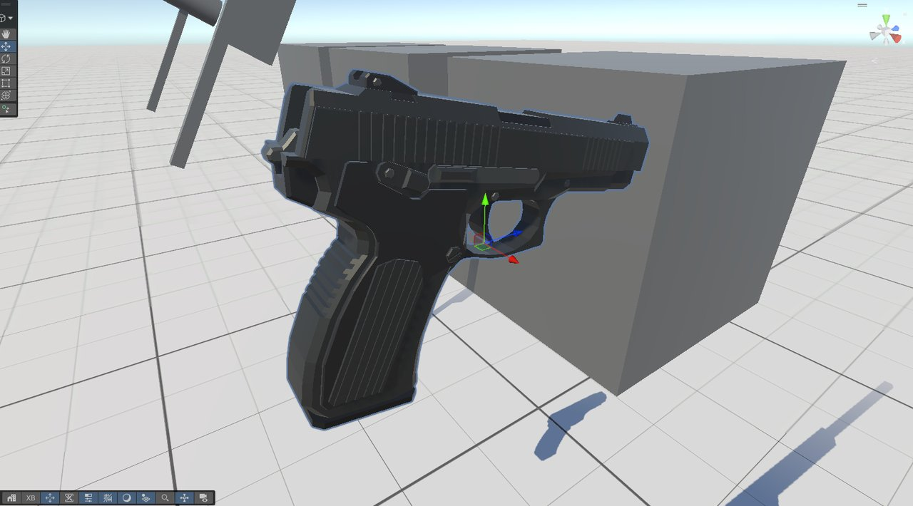 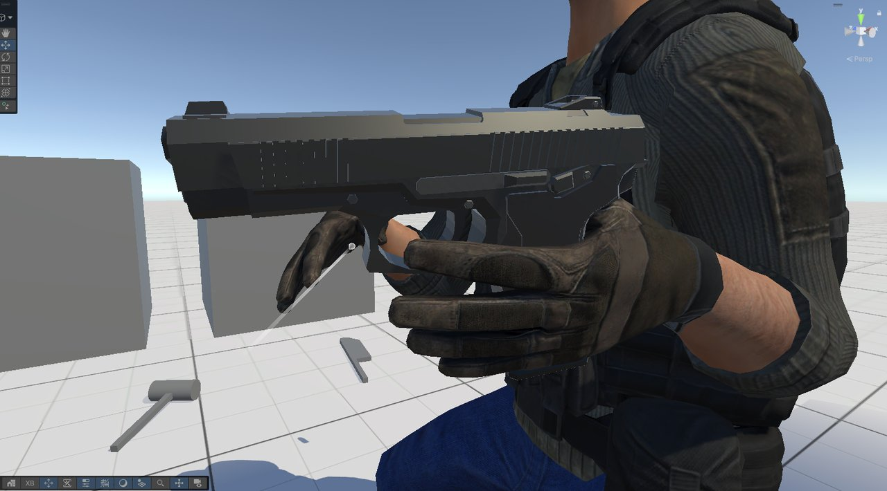
</details>

### Trincle

`Team of 6` `4 months` `Unity` · Development paused

Top-down pixel action game with weapon skills, crafting, and procedural maps.

- Top-down movement and state-based sprite animation
- Shader-based weapon skills, hit VFX, and an optimized attack shader
- Perlin-noise procedural map generation
- ScriptableObject-driven item drops and dialogue, inventory and crafting UI, all SFX

<details>
<summary><b>Screenshots</b></summary>
<br>
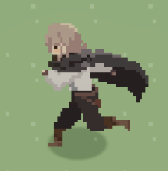  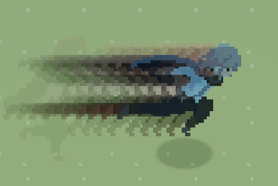
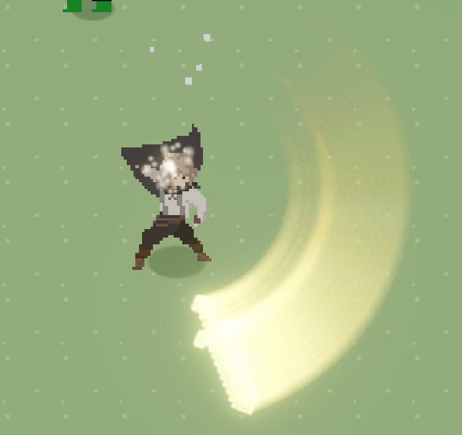 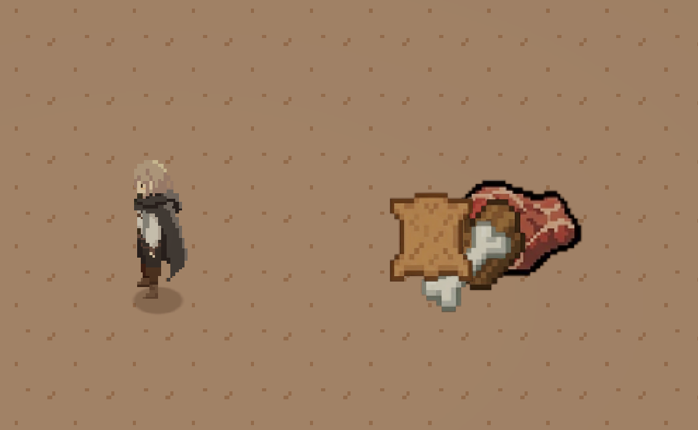
 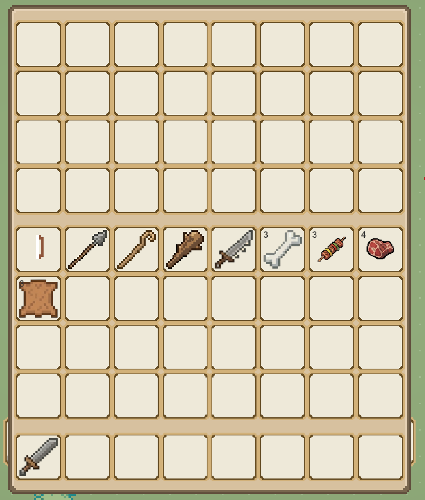

</details>

### Music of the Soul

`Solo` `8 months` `Unity` `PlayFab` `Photon`

Rhythm game with online versus mode. My first full game, built before using AI agents.

- PlayFab sign-up, login, and in-game data sync
- Photon multiplayer
- Object pooling and Profiler-driven memory and script optimization

<details>
<summary><b>Screenshots</b></summary>
<br>
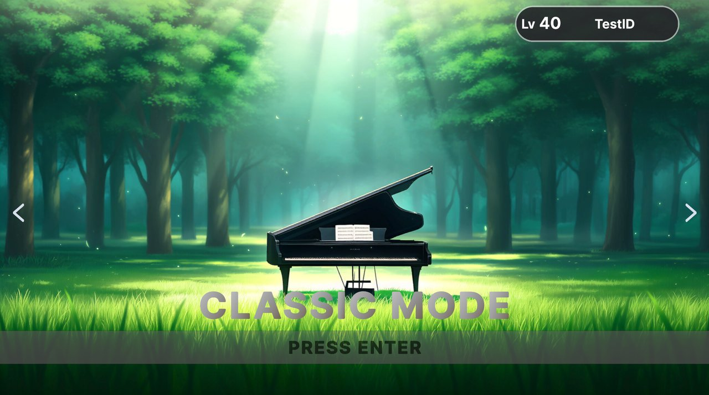 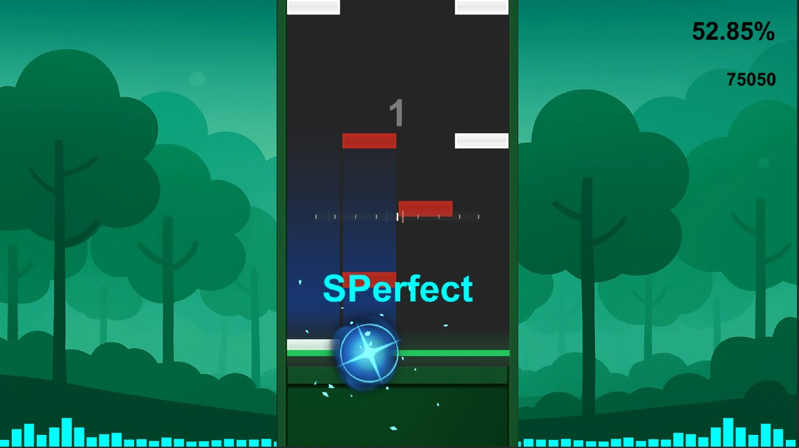
</details>

### Snow Removal Master

`Solo` `TypeScript` `React` `Three.js` · [▶ Play](https://snow-removal-master.vercel.app)

Low-poly 3D one-stroke puzzle with a procedural Endless mode and a stage editor. All 42 tasks tracked as brief → report → independent review.

---

## AI Projects

### Multi-Agent Development Workflow

`Personal architecture` · Applied across the game projects above

Single agents drifted out of scope, guessed at unstated requirements, and missed their own bugs. I split the work across role agents with explicit approval gates.

- **Roles:** Coordinator, Planner, Plan Reviewer, Builder, Code Reviewer, Reporter. Reviewers never edit.
- **Risk tiers:** T0 / T1 / T2. Plan review and a second approval only for risky work.
- **Decision states:** Confirmed / Candidate / Open Gate, so a guess never becomes a requirement.
- **Handoffs:** pass objective, approvals, and constraints instead of full logs to cut token use.

<details>
<summary><b>Workflow</b></summary>

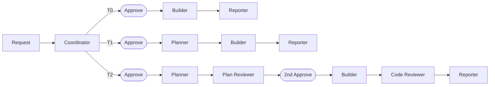

</details>

<details>
<summary><b>How it evolved</b></summary>

```
2025      Game dev fundamentals without agents
2026.04   Rule files and Unity MCP as assistants
2026.08   Fixed roles (plan → build → review) with a task ledger
2026.09   Contract- and test-first development; dropped the fixed roles
2026.10   Risk-based routing, dynamic orchestration, evidence gates
2026.11   Parallel agent team ships a game in a week; built an AI-output QA tool
```

</details>

### [SlopLens](https://github.com/Naul-s/slop-lens)

`Solo` `Open source` `Python` `MCP` `Unity`

Claude Code plugin and MCP server that explains why an AI-made game or website feels like "AI slop", with evidence and fixes.

- Unity autoplay package that captures gameplay frames and mixed audio for review
- Works with Claude Code, Gemini CLI, Codex, and Cursor
- Validation results published, including failures

### Local Real-Time Translator

`Solo` `3 days` `Chrome extension` `WebGPU`

Translates live audio from YouTube or Twitch into subtitles entirely in the browser, with no cloud API.

- Tab audio → AudioWorklet VAD → Whisper STT → Qwen2.5 or OPUS-MT, each model in its own Web Worker
- q4/q8 quantized models on WebGPU, WASM fallback for STT
- System prompt, few-shot examples, and decoding settings tuned so the LLM outputs only the translation; token-streamed subtitles

<details>
<summary><b>Screenshots</b></summary>
<br>
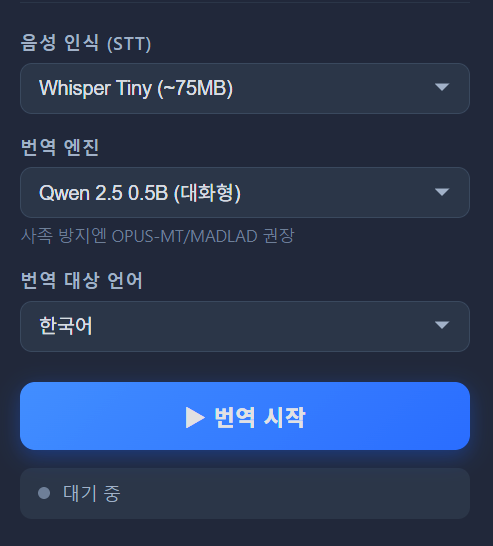 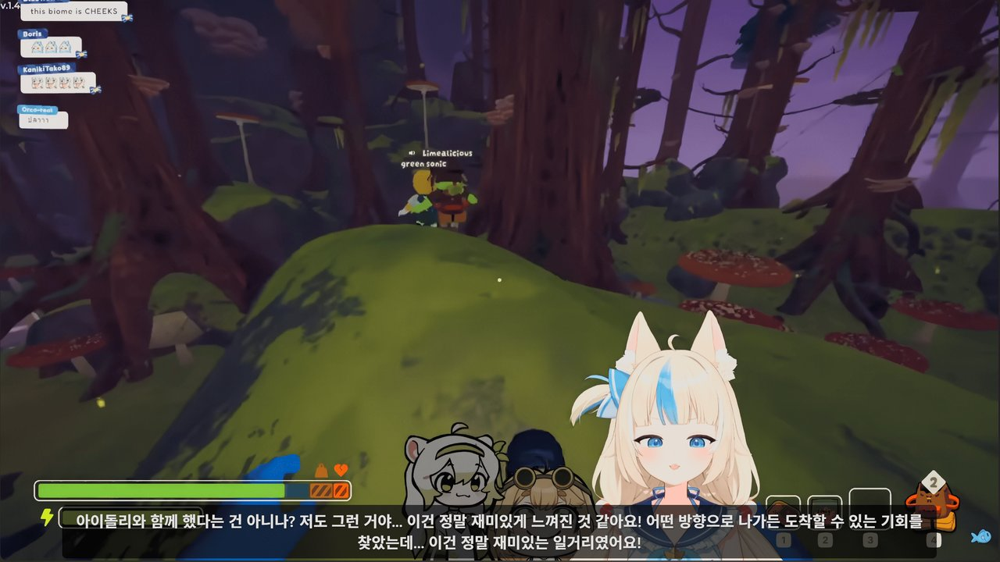
</details>

### AI Vision Assistive Device

`Solo` `8 hours` `Raspberry Pi` `Python` · Jeonju Youth IP Hackathon **Gold Prize**

A camera on a Raspberry Pi sends images to a vision AI API and describes what is in front of a visually impaired user.

- Set up the Raspberry Pi Linux environment and wired camera input to the API in Python
- Tuned prompts so answers stay short and never state uncertain details as fact

<details>
<summary><b>Photos</b></summary>
<br>
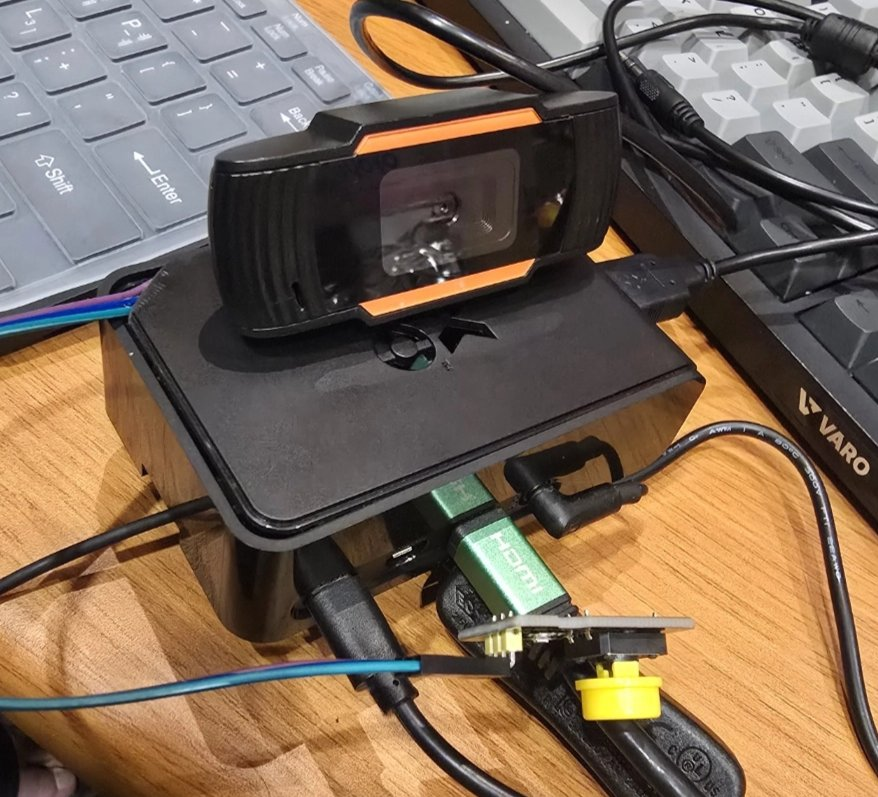 
</details>

---

## Awards & Activities

| Date | |
|---|---|
| 2025.12 | Jeonju Youth IP Hackathon — **Gold Prize** |
| 2025.06 | Craftsman Information Processing (정보처리기능사) |
| 2025.04 – | Co-founder & president, school game development club · taught C# and Unity |
| 2024.04 | Regional Skills Competition — **Silver Medal** |
